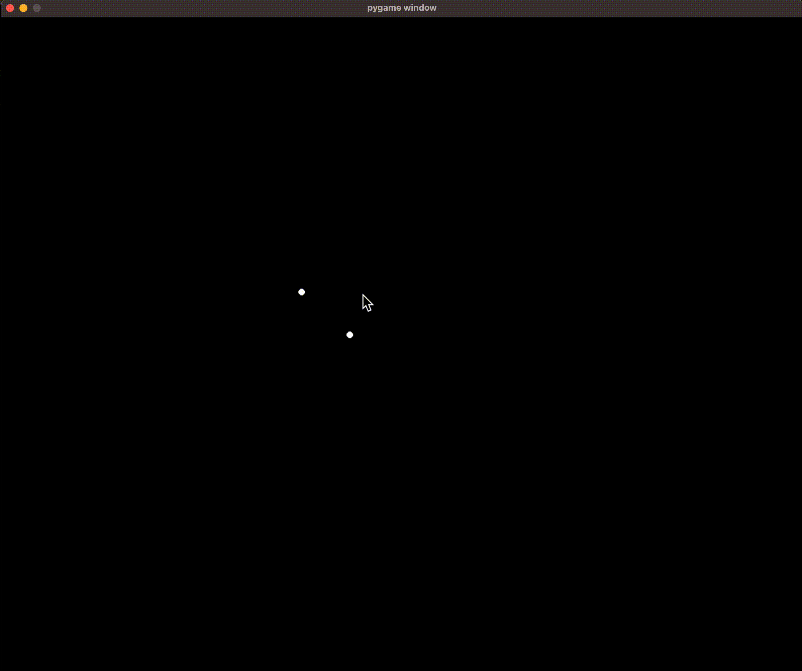

<div align="center">

# 🪐 2D Gravity Physics Simulator

*A simple, fun, and interactive simulation to explore N-body gravitational interactions.*

[Features](#-version-2-optimizations--updates) • [Demo](#-demo) • [Getting Started](#-how-to-run)

</div>

---

## 🎯 Objective

The goal of this project is to create an intuitive sandbox where you can observe how multiple objects with custom radii and densities interact through mutual gravitational pull.

> **Controls:** Left-click anywhere on the Pygame window to spawn a new ball and watch the physics unfold!

---

## 🎥 Demo

<p align="center">
  
</p>
<p align="center">
  <em>Movable Center Mass (Left) &nbsp;&bull;&nbsp; Stationary Center Mass (Right)</em>
</p>

---

## 🚀 Version 2 Optimizations & Updates

This version brings major performance upgrades, physical accuracy improvements, and new customization features:

* **⚡ Verlet Integration:** Switched from standard Euler integration to Verlet integration for superior stability and accuracy in orbital mechanics.
* **🧮 Computation Optimization:** Pre-computed and stored mass directly inside the `Ball` class to eliminate redundant calculations per frame.
* **⚖️ Bug Fix:** Corrected a critical mass calculation error (changed from $m = \frac{d}{v}$ to the physically correct $m = d \times v$).
* **⏱️ Delta Time ($\Delta t$):** Replaced fixed time steps (0.016s) with a dynamic `dt` variable to ensure smooth, frame-rate independent movement.
* **🧹 Code Structure:** Refactored and organized control logic neatly into a `main()` function.
* **🧱 Wall Collisions:** Added wall collision boundaries controlled by a bounce factor constant (`B`).
* **🌟 High-Density Mass:** Added support for an optional high-density anchor mass configurable via the terminal (choose density and whether it remains stationary or moves freely).

---

## 🛠️ How to Run

1. Make sure you have Python and Pygame installed:
   ```bash
   pip install pygame
